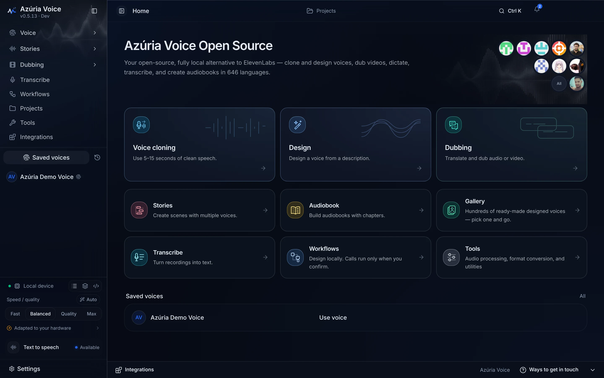

# Marca Azúria Voice

Nome de exibição: **Azúria Voice**, preservando o acento. O símbolo usa uma onda sonora contínua, semelhante a um M, em prata e azul, com um pequeno buraco negro no canto superior direito. O desenho usa cores chapadas e formas simples para funcionar em tamanho pequeno.

| Papel | Cor |
|---|---|
| Azul principal | `#2563EB` |
| Prata | `#CBD5E1` |
| Azul escuro | `#0B1220` |

O kit em `assets/brand/` contém a fonte SVG, PNG transparente, ICO Windows com múltiplas resoluções, versão horizontal com o nome e versões monocromáticas. Consulte [o inventário e a exportação](../assets/brand/README.md). Os ícones derivados da mesma fonte ficam em `electron/build/icons/`; `electron/public/favicon.svg` abastece o navegador e a marca na interface.

Não mude a estrutura das telas nem o lugar das funções para aplicar a marca. O visual muda pelos tokens, pela moldura e pelos componentes base (veja abaixo), mantendo a legibilidade de texto, estados de foco e mensagens de erro.

## Sistema visual Azúria 2

Ar calmo e limpo, inspirado no ElevenLabs, com a identidade prata e azul. Um sistema só para o app inteiro:

| Item | Valor |
|---|---|
| Fundo escuro / claro | `#070B14` (azul-noite) / `#F5F7FA` (gelo) |
| Cartões escuro / claro | `#0E1524` / `#FFFFFF`, borda fina com pouca opacidade |
| Texto escuro / claro | `#E6EBF2` (prata) / `#0B1220` |
| Ação (único acento) | `#2563EB`; texto de destaque e foco `#60A5FA` (escuro) / `#1D4ED8` (claro) |
| Cantos | 8 / 12 / 16 px (`--radius: 0.75rem`) |
| Botão principal | pílula; secundários com cantos de 12 px |
| Tempo | 80 / 150 / 250 / 350 / 500 ms (`--dur-*`) |
| Curvas | saída `cubic-bezier(0.22, 1, 0.36, 1)`, mola `cubic-bezier(0.34, 1.36, 0.64, 1)` |

Regras:

- Sem violeta, fúcsia, roxo ou índigo na interface padrão (`tests/frontend/azuriaTheme.test.mjs` falha se aparecerem). As paletas que a pessoa escolhe em Aparência mantêm as próprias cores.
- Cartões com link sobem 2 px ao passar o mouse (`lift-on-hover`); controles usam `transition-ui`.
- A primeira tela entra uma vez ao abrir; nada aparece enquanto a página rola. "Reduzir movimento" e "reduzir transparência" do sistema são respeitados.
- No máximo dois destaques: a luz que segue o ponteiro nos cartões do início (`use-spotlight.ts`) e a entrada única do título.
- Referências: [Taste Skill](https://github.com/Leonxlnx/taste-skill) (regras), [transitions.dev](https://transitions.dev) (escala de tempo) e [React Bits](https://reactbits.dev) (ideias de efeito). **Não copie código** do transitions.dev nem do React Bits: as licenças deles proíbem redistribuir os componentes, o que conflita com a AGPL. Use só os números e as ideias, com implementação própria.
- Ao mudar tokens, rode `bun scripts/export-mobile-tokens.ts` (os apps de celular leem o mesmo tema).

## Identificadores de compatibilidade

A marca de exibição é independente dos contratos internos. Preserve os imports `omnivoice`, IDs e nomes dos modelos, variáveis `OMNIVOICE_*`/`VOICESTUDIO_*`, chaves de armazenamento, IPC, cabeçalhos e rotas de API. Os diretórios de dados/modelos continuam sob o gerenciamento existente. Não acrescente números de versão aos caminhos persistentes.

Referências aos autores originais, licenças e nomes de serviços externos permanecem onde sua identificação é necessária. A distribuição e as atualizações do Azúria usam `kaikydev1-jpg/azuria-voice`.
